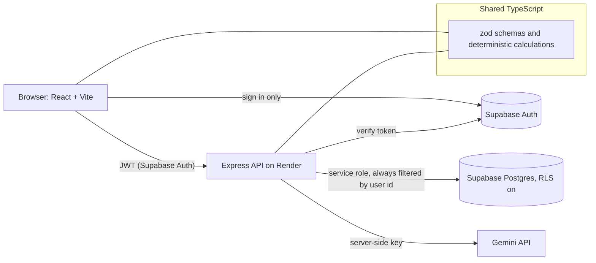

# Festiva AI

**Big celebrations. Thoughtful plans. Zero chaos.**

A GenAI-powered planning assistant for weddings, birthdays, anniversaries, community and college events. It turns a short form into a personalised plan, then keeps the budget, timeline, vendors and an event-aware AI copilot in one saved workspace. Built for **Challenge 5: Celebration & Event Planner**.

- Live app: _add after deployment_ (see [Deployment guide](docs/DEPLOYMENT.md))
- Demo video: _add after recording_ (script in [docs/SUBMISSION.md](docs/SUBMISSION.md))
- Architecture and conventions: [docs/ARCHITECTURE.md](docs/ARCHITECTURE.md) · [CONTRIBUTING.md](CONTRIBUTING.md) · [SECURITY.md](SECURITY.md)

> **Verification status, stated plainly.** Everything below marked "tested" was run in the development environment: 212 unit/integration tests, 3 browser tests, lint, type check, production build and `npm audit`. The app has **not** yet been run against a real Supabase project or the real Gemini API (those need your accounts and keys), and it is **not yet deployed**. The Gemini request body uses the documented SDK field names (`responseMimeType`, `responseJsonSchema`) but could not be exercised here, so confirm it with `scripts/verify-deployment.mjs` first. [docs/DEPLOYMENT.md](docs/DEPLOYMENT.md) covers exactly how to deploy and confirm.

## Problem and why it helps

Planning a celebration means juggling spreadsheets, family opinions, vendor quotes and dozens of deadlines, often with a budget that quietly drifts. Festiva AI gives one calm place to:

- see a realistic budget split and what is left as expenses change;
- get dated tasks worked back from the event date (a wedding starts months out, a birthday weeks out);
- track vendor quotes, advances and payments you enter yourself;
- ask an assistant that actually knows your event, and approve any change it proposes.

India-first: INR with Indian digit grouping (₹12,34,567), Indian date format, vegetarian / Jain / non-vegetarian catering options, monsoon-aware warnings and Indian vendor categories. The data model keeps `currency` as a field so other currencies can be added later.

## Features

| Area                   | What works                                                                                                                                                                                                                                                                         |
| ---------------------- | ---------------------------------------------------------------------------------------------------------------------------------------------------------------------------------------------------------------------------------------------------------------------------------- |
| Landing and onboarding | Hero, "Plan My Event" / "Explore Features", feature cards, interactive budget preview, privacy footer, short event form with sensible defaults                                                                                                                                     |
| AI event plan          | Concept and theme, budget split, itemised estimates, timeline, vendor checklist with questions to ask, guest checklist, decor / food / activity / entertainment ideas, day-of schedule, risks with contingencies, cost-saving tips, personal recommendations, clarifying questions |
| Budget manager         | Planned vs estimated vs actual per category, remaining, % consumed, add / edit / delete expenses, vendor-linked expenses, donut chart with a data table alternative, overspending warnings, reallocation suggestions, AI cost-saving ideas                                         |
| Tasks                  | Generated from event type and date, priority, status, category, notes, overdue flags, upcoming deadlines, filters, list and chronological timeline views, completion %                                                                                                             |
| Vendors                | Ten categories, quote, advance, payment and booking status, follow-up dates (with due flags), linked tasks and expenses, totals and pending payments. User-entered records only                                                                                                    |
| Copilot                | Uses the saved event, budget, tasks and vendor names; quick prompts; proposes tasks or budget moves that apply **only after you press Apply**                                                                                                                                      |
| Workspace              | Dashboard of event cards, sample workspace on demand, edit and delete with confirmation, loading / empty / error states, all data persisted per user                                                                                                                               |

## Architecture



| Directory             | Purpose                                                                                                                                                    |
| --------------------- | ---------------------------------------------------------------------------------------------------------------------------------------------------------- |
| `client/`             | React 19 + Vite + TypeScript UI. `pages/`, `features/<area>/`, `components/ui/` (design system), `lib/api.ts`                                              |
| `server/`             | Express API: `routes/`, `middleware/`, `data/` (repository interface, Supabase and in-memory implementations), `ai/` (the only code that talks to a model) |
| `shared/`             | Code used by both sides: zod schemas, constants, **all budget / task / vendor maths**, task templates, plan normaliser                                     |
| `supabase/schema.sql` | Tables, constraints, indexes, RLS                                                                                                                          |
| `e2e/`                | Playwright browser tests (real Express app, in-memory data, canned AI)                                                                                     |
| `scripts/`            | `check-contrast.mjs` (WCAG colour pairs), `verify-deployment.mjs`                                                                                          |
| `docs/`               | Deployment guide, API reference, submission text                                                                                                           |

Design choices a beginner can follow: one language everywhere, one source of truth for validation (`shared/schemas.ts`) used by form, API and AI-output checks, and a repository interface so the database can be swapped or faked.

## GenAI integration

- **Provider and model:** Google Gemini via the REST API, model `gemini-3.6-flash` (configured by `GEMINI_MODEL`, nothing hardcoded elsewhere). I checked Google's model and deprecation pages on 22 Oct 2026: older 2.0 models are shut down and 3.6 is a current stable Flash model. Model names change often, so re-check before submitting.
- **Where it is used** (all in `server/ai/`): full plan generation, copilot chat, AI cost-saving ideas. Task generation from the plan reuses the stored plan, with no extra model call.
- **Pattern:** `AiService` interface → `geminiService` → `geminiClient`. Swapping providers means writing another `AiService`.
- **Structured output:** Gemini is given a JSON Schema generated from the zod schema, and the reply is validated again with zod. A malformed reply is retried once, then fails with a clear error; a reply cut off by the token limit fails immediately with its own message (thinking tokens share that limit, so limits include headroom, and `GEMINI_THINKING_LEVEL` can lower the effort). Provider errors, rate limits, timeouts (default 90 s) and a missing key map to specific 4xx/5xx codes. With no key the API answers `503 AI_NOT_CONFIGURED`. It never fabricates output.
- **Prompt safety:** fixed rules live in the system instruction; user and event data go in a separate message as labelled JSON data. Vendor contact details are never sent. Inputs, history and event snapshots are length-bounded.
- **Deterministic maths:** the model returns percentages and itemised estimates; rupee amounts per category, totals, remaining balance, progress and overspending are computed in `shared/calc/`. The server adds a warning when the AI's own estimates exceed your budget.
- **Honesty rules in the prompt and UI:** everything AI-made is labelled a suggestion; amounts are estimates with stated assumptions; no vendor names, availability, quotes, or legal requirements are invented.
- **Copilot cannot silently change data.** Proposals are validated against the real event (impossible moves are dropped) and shown with an Apply button.
- **Cost control:** one model call per request, in-flight guard per event, per-user rate limit (20 AI calls / 10 min).

## Security

Tested in `server/*.test.ts` unless noted.

- Supabase Auth (no home-made passwords). Every private route verifies the JWT; every query filters by the verified user id; another user's event, task, vendor or expense returns 404 (including via your own event id with someone else's item id).
- Database: RLS enabled on all tables with **no policies**, privileges revoked from `anon` / `authenticated`: the public anon key cannot read data even if misused.
- zod validation on client and server; rejects negative, fractional, non-numeric and oversized amounts; strips control characters; 50 kB body limit; bounded list sizes.
- Helmet, strict JSON-only CSP on the API, CORS limited to `CORS_ORIGINS`, general and AI rate limits, `x-powered-by` removed, generic 500s in production, no keys/prompts/model output in logs (tested).
- Secrets only in environment variables; `.env.example` has placeholders; `.env` is git-ignored; the browser only holds the public anon key.
- React escapes all rendered text; there is no `dangerouslySetInnerHTML`.
- Web CSP (in `vercel.json`) checked in a real browser with zero violations. It needs `style-src 'unsafe-inline'` because the UI uses some inline `style` attributes.

## Accessibility

Target WCAG 2.2 AA. Semantic landmarks and heading order, skip link, labelled controls with linked hints and errors (`aria-invalid`, `aria-describedby`), native `<dialog>` modals with focus return, visible focus ring, 44 px touch targets, status/validation announced via live regions, errors and statuses always carry text or icons (never colour alone), the donut chart has a full data table, scrollable regions are keyboard-focusable, `prefers-reduced-motion` respected. Colour pairs are checked by `node scripts/check-contrast.mjs`. Automated: axe-core in unit tests and **in the real browser (including colour contrast)** on landing, plan, budget, tasks and vendors screens, with zero violations. **Not done:** a manual screen-reader pass (NVDA/VoiceOver); automated tools find only part of WCAG issues.

## Testing

| Layer                 | Tool                                                 | Result when last run      |
| --------------------- | ---------------------------------------------------- | ------------------------- |
| Unit, API, components | Vitest, React Testing Library, Supertest, vitest-axe | **212 passed** (16 files) |
| Browser journey + axe | Playwright                                           | **3 passed**              |
| Types / lint          | `tsc`, ESLint (+ jsx-a11y)                           | clean                     |
| Dependencies          | `npm audit`                                          | 0 vulnerabilities         |

Covers: event form validation (invalid dates, guest counts, budgets), budget totals / remaining / overspend, expense create and update, task progress, vendor payments, AI schema validation, missing / invalid AI config, provider failures and timeouts, API validation, authentication and cross-user access, main navigation and creation flow, and the full browser journey (create → AI plan → expense updates balance → task → vendor → copilot proposal needs Apply → data survives reload). External services are mocked in tests; the production AI client is real and untouched by the mocks. The browser tests use a canned AI answer, so **the live Gemini call itself is verified only by `verify-deployment.mjs` with your key**.

```bash
npm test            # unit + API + component tests
npm run test:e2e    # Playwright (set PW_CHROMIUM_PATH if Chromium is pre-installed)
npm run lint && npm run typecheck && npm run build
```

## Local setup

Requires Node 20.6+ (22 recommended).

```bash
npm ci
cp .env.example .env     # then fill in the values (see below)
# Create the database: Supabase dashboard → SQL Editor → paste supabase/schema.sql → Run
npm run dev:server       # API on http://localhost:8787
npm run dev:client       # app on http://localhost:5173 (proxies /api to the API)
```

| Variable                                          | Where | Purpose                                                      |
| ------------------------------------------------- | ----- | ------------------------------------------------------------ |
| `SUPABASE_URL`, `SUPABASE_SERVICE_ROLE_KEY`       | API   | Database and token verification. **Secret.**                 |
| `GEMINI_API_KEY`, `GEMINI_MODEL`, `AI_TIMEOUT_MS` | API   | AI provider. Key is **secret**                               |
| `CORS_ORIGINS`                                    | API   | Exact web origin(s), required in production                  |
| `PORT`, `TRUST_PROXY`, `APP_TIME_ZONE`            | API   | Optional; defaults 8787 / 1 hop in production / Asia/Kolkata |
| `VITE_SUPABASE_URL`, `VITE_SUPABASE_ANON_KEY`     | Web   | Sign-in only (public values)                                 |
| `VITE_API_URL`                                    | Web   | API origin in production; empty locally                      |

Supabase also needs Authentication → Providers → Email enabled. For quick demos you may turn off "Confirm email"; otherwise new users must confirm first.

## Deployment

Vercel (web) + Render (API) + Supabase (auth, database) + Gemini. Exact click-by-click settings, the Render blueprint (`render.yaml`), `vercel.json`, and verification steps are in **[docs/DEPLOYMENT.md](docs/DEPLOYMENT.md)**. API reference: **[docs/API.md](docs/API.md)**.

## Production build size

`npm run build:client` with real Supabase variables: main chunk ≈ **510 kB (149 kB gzipped)**, which includes the Supabase auth client; pages load as separate lazy chunks (the largest, the budget tab, is ≈ 15 kB), CSS ≈ 15 kB (4 kB gzipped). Without the variables the auth client is tree-shaken, so measure with them set. The chunk-size warning from Vite is expected for this reason.

## Repository size

```bash
git count-objects -vH                                   # size of history
du -sh --exclude=node_modules --exclude=dist --exclude=.git .   # working tree
git rev-list --objects --all | git cat-file --batch-check='%(objecttype) %(objectname) %(objectsize) %(rest)' | awk '$1=="blob"' | sort -k3 -n -r | head   # largest files ever committed
git log --all -p -S"AIza" --oneline | head              # any Gemini-style key ever committed (expect nothing)
```

Source tree measured at ≈ 1.1 MB without `node_modules`, `dist` and `.git`, far below the 10 MB limit.

## Known limitations

- Not yet deployed or run against live Supabase / Gemini (see top).
- Render's free API sleeps after ~15 minutes idle, so the first request can take about a minute; open the site once before recording a demo. Free Supabase projects pause after ~1 week of inactivity.
- Vercel Hobby is for non-commercial use, which suits a competition entry.
- AI plans are one large structured response and may take 15–60 s depending on model load and thinking effort; there is no streaming.
- Free Gemini tier limits are shared and can change; heavy use may return a "busy" message.
- The copilot conversation is not saved (only the plan and your data are).
- Vendors are records you enter; there is no vendor directory or availability checking by design.
- INR only in the UI today (currency is stored as a field for future expansion).
- Account deletion, email invites and multi-user collaboration on one event are not implemented.
- Chart is a donut with a table alternative; no trend charts.
- No manual screen-reader audit yet.

## Future improvements

Streaming AI output, shared events with roles, calendar (.ics) export, printable plan / PDF, guest list and RSVP tracking, multi-currency, saved copilot history, real vendor discovery through a verified source.

## License

MIT, see [LICENSE](LICENSE).
